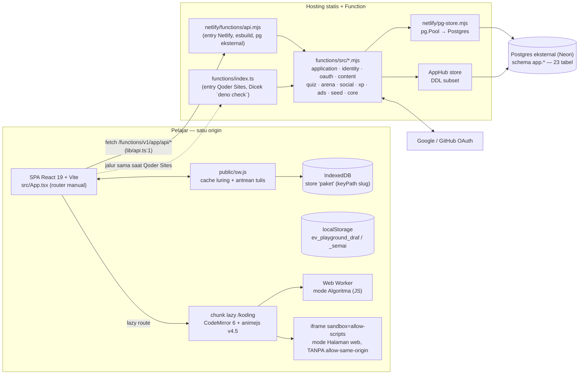
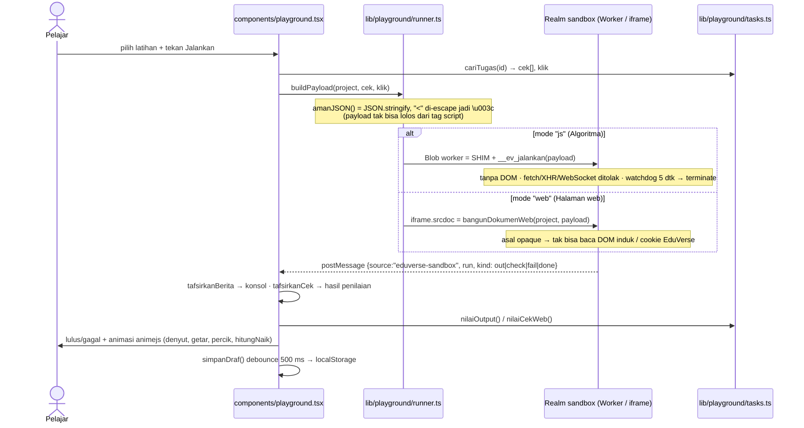
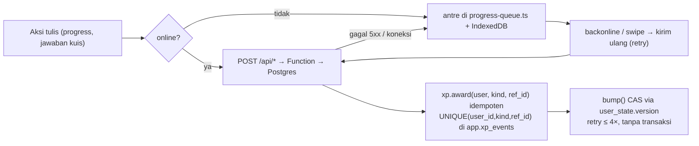

# EduVerse — Diagram arsitektur & alur

Dipetakan dari tree saat ini (commit `e2675df` + pekerjaan belum ter-commit di `/koding`).

## 1. Komponen

Kedua entry berbagi satu `functions/src/*` — jalur URL `/functions/v1/app/*` dijaga identik
supaya frontend, service worker, dan aturan asal permintaan tidak perlu cabang per host.

## 2. Sandbox playground (dua mode)

## 3. Alur tulis luring (tetap konsisten saat offline)

## 4. Gerbang verifikasi yang ada di repo

| Perintah | Isi | Status terverifikasi (2026-11-05) |
|---|---|---|
| `npm run test:function` | `dev/*.test.mjs` — 77 tes: Function, pg-store, entry Netlify + Vercel, playground, draf, skema, penjaga rute + penjaga nama env di dokumen | lulus 77 / gagal 0 (terukur 2026-11-14; angka lama 75 ditulis sebelum dua tes jalur hapus sesi masuk, 74 sebelum penjaga env) |
| `npm run build` | `tsc --noEmit` + `scripts/build.mjs` | hijau, `dist/assets/koding-DhGcim_f.js` 27,31 kB · CSS 164,26 kB (terukur 2026-11-09) |
| `npm run check:function` | `deno check functions/index.ts` | butuh Deno |
| penjaga skema | `dev/schema.test.mjs` — migrasi masuk subset DDL AppHub, tak ada tabel yatim, kolom Function ada di skema | lulus |

## 5. Keputusan per lingkungan host (bukan bug — jangan "diperbaiki" dengan menambah variabel)

| Host | Variabel Function | Konsekuensi yang SAH | Penjaga |
|---|---|---|---|
| Vercel Production | `DATABASE_URL`, `DATABASE_POOL_MAX`, `DATABASE_SSL` (`api/index.mjs:21-30`) + `APP_SESSION_SECRET`, `APP_ADMIN_IDENTITIES`, `APP_GOOGLE_CLIENT_ID`/`_SECRET`, `APP_GITHUB_CLIENT_ID`/`_SECRET`, `APP_PUBLIC_URL` (`api/index.mjs:35-42`) | `/api/health` 200 `{"providers":{"google":true,"github":true,"platform":false}}`, `/api/catalog` 401 `login_required` untuk anonim, rute tak dikenal 404 `not_found` — semuanya diukur langsung dari `eduverselearn.vercel.app` lewat curl 2026-11-09, bukan dari harness | `dev/vercel-entry.test.mjs` + penjaga nama env di `dev/route-sync.test.mjs` |
| Vercel Preview | **sengaja tanpa `DATABASE_URL`** (keputusan pemilik 2026-11-09) | `api/index.mjs:22` melempar saat impor → `FUNCTION_INVOCATION_FAILED` (500) untuk SEMUA `/api/*`, termasuk `/api/health`. Artinya: **login OAuth di Preview tidak akan pernah selesai** dan halaman yang butuh katalog akan gagal. 500 di Preview BUKAN regresi. | test `Preview tanpa DATABASE_URL gagal cepat di impor, dan itu keputusan — bukan regresi` (menjalakan `import('./api/index.mjs')` dengan env tanpa `DATABASE_URL` dan menuntut galat) |
| Netlify (Production + Preview) | tidak terverifikasi dari agen — situs memakai Team protection: `/`, `/api/health`, `/functions/v1/app/api/health` semuanya 401 · `server=Netlify` (terukur 2026-11-09) | Di SUMBER, prefiks `/functions/v1/app/*` hanya dipasang di `netlify/functions/api.mjs` (`config.path`). Apakah host-nya masih melayani kedua prefiks BELUM terbukti: butuh akun anggota tim yang masuk ke dashboard. | `dev/route-sync.test.mjs` (sumber saja) |

Sepuluh batas yang sering salah dibaca:

1. **Prefiks warisan hanya terpasang di Netlify.** Vercel mengambil rute dari nama berkas
   (`api/index.mjs` → `/api`) dan `vercel.json` tidak punya rewrite untuk `/functions/v1/*`,
   jadi di `eduverselearn.vercel.app` path itu 404 halaman `NOT_FOUND` platform (terukur
   404 · 79 B · 2026-11-09). Router inti tetap mengenal prefiksnya, jadi test titik masuk
   yang memakai prefiks itu membuktikan `applicationPath`, bukan dua host.
2. **Vercel terhubung ke Git dan `git push` yang menaikkan produksi.** Terukur 2026-11-09:
   push `bd7b67c..0e46589` membuat deployment production 18 detik lalu tanpa `vercel deploy`
   (alias `eduverse-git-main-…` ada, sha push membawa status GitHub `context=Vercel
   state=success`), dan `eduverselearn.vercel.app` kini menyajikan `index-CdlodoQH.css`
   = sama byte-nya dengan build lokal. Jangan simpulkan "tidak terhubung ke Git" dari
   `vercel inspect`: CLI 65.12.1 tidak mencetak baris repository di blok General.
3. **Build yang pernah diunggah lewat CLI meninggalkan artefak CSS.** Deployment lama
   (`index-3-DTADYc.css`, 173,269 B) adalah superset ketat dari build git (`164,265 B`):
   90 aturan ekstra, 0 aturan hanya-lokal, dan 70 di antaranya nama kelas yang ditulis apa
   adanya di `node_modules/tailwind-merge/dist/bundle-mjs.mjs` — Tailwind v4 ikut menscan
   node_modules di lingkungan build itu. Build dari Git sudah tidak mengulanginya.
4. **Penjaga asal mutasi tidak memakai env apa pun.** Yang bekerja adalah
   `sameOrigin(request)` di `functions/src/core.mjs:121-129`, dipanggil
   `requireMutationOrigin(request)` (`functions/src/core.mjs:131-133`): host header `origin`
   dibandingkan dengan host `request.url`, beda → 403 `origin_mismatch`. Dokumen ini pernah
   menamai satu variabel "daftar asal yang diizinkan" yang tidak dibaca kode mana pun
   (namanya sengaja tidak ditulis ulang di sini), dan sudah dihapus; penjaga
   `setiap nama env yang ditulis di dokumen...` di `dev/route-sync.test.mjs` tidak
   mengizinkannya kembali.
5. **`/ads.txt` 404 hari ini berarti berkasnya belum pernah ada, bukan salah rute.**
   `public/` berisi `icon.png`, `icon.svg`, `manifest.webmanifest`, `offline.html`,
   `robots.txt`, `sitemap.xml`, `sw.js` — tidak ada `ads.txt`, dan `grep -rn "ads.txt"` di
   seluruh repo (node_modules dikecualikan) = 0 rujukan. `git show --stat bd7b67c` hanya
   menambah `public/robots.txt` dan `public/sitemap.xml`, jadi frasa commit "berkas perayap
   AdSense" melebih-lebihkan. Keputusan pemilik 2026-11-09: berkas DITUNDA sampai akun
   AdSense punya publisher-id — jangan membuat file, jangan membuat placeholder. Gap ini
   tetap terbuka dan akan menahan persetujuan akun iklan.
6. **Risiko terbuka yang sengaja tidak ditutup:** pemindaian Tailwind v4 tidak dibatasi
   `@source`, jadi build di lingkungan tanpa repositori Git tetap bisa menyerap utility dari
   `node_modules`. Pemilik memutuskan `src/globals.css` TIDAK diubah sekarang, karena build
   Git sudah terbukti menghasilkan byte yang sama dengan lokal.
7. **Login OAuth nyata SUDAH selesai pada host yang memakai Neon produksi — atribusi host-nya
   belum terbukti, dan yang kosong bukan login-nya tapi datanya.**
   Terukur 2026-11-09 lewat peramban: klik "Lanjut dengan Google" di `/masuk` memanggil
   `/api/auth/start?provider=google` dan mendarat di `accounts.google.com/v3/signin/accountchooser`
   membawa `client_id=156265574443-…usercontent.com`, `redirect_uri=https://eduverselearn.vercel.app/api/auth/callback`,
   `scope=openid email profile`, `prompt=select_account`, dan `state` 64 karakter heks.
   Sisi setelahnya terbukti dari data, bukan dari perkiraan: `app.users` berisi SATU baris
   `identity` berprefix `google:` dengan email nyata (dibuat `2026-11-08T21:48:15Z`) dan
   `app.sessions` berisi TIGA baris — dibuat `21:48:15Z`, `23:30:22Z`, `23:58:02Z` (semua UTC;
   = 04:48, 06:30, 06:58 +07 pada 2026-11-09), dua masih berlaku sampai `2026-12-08T23:30:22Z`
   dan `2026-12-08T23:58:02Z` (= 2026-12-09 06:30 dan 06:58 +07).
   Satu-satunya penulis baris sesi adalah `identity.startSession()`
   (`functions/src/identity.mjs:81-92`), dan satu-satunya pemanggilnya adalah
   `functions/src/oauth.mjs:128` — jalur callback setelah tukar-token IdP berhasil. Tidak ada
   jalur login-dev lain, jadi baris itu tidak mungkin muncul dari harness: `dev/fake-db.mjs`
   yang dipakai naskah bukti tidak menyentuh Neon produksi sama sekali.
   Header cookie juga sudah diukur langsung dari host, bukan hanya dari harness (curl
   `…/api/auth/start?provider=github` → `302` + `Set-Cookie: ev_oauth=<masked>; HttpOnly;
   SameSite=Lax; Path=/; Max-Age=600; Secure`): host benar-benar menerbitkan cookie Secure.
   Yang TIDAK dibuktikan data itu adalah host mana yang melayaninya. `app.sessions` cuma punya
   empat kolom — `SELECT column_name FROM information_schema.columns WHERE table_schema='app'
   AND table_name='sessions'` → `id`, `user_id`, `expires_at`, `created_at`; tidak ada kolom
   `host`, `deployment`, apalagi `issuer`. Karena situs Netlify lama dan Vercel sekarang memakai
   `DATABASE_URL` Neon yang sama, baris sesi mana pun bisa berasal dari salah satunya.
   Daftar deployment terlama yang masih tersedia lewat CLI saat ini (`vercel ls`, 10 baris
   terbaru) berakhir di `…/eduverse-8t9iz0rqj-…` yang `vercel inspect` laporkan sebagai
   `dpl_FPDHiRC1pwy322RDmq5LykrUD57f`, dibuat `Mon Nov 09 2026 02:48:43 GMT+0700` — 1 jam
   59 menit 32 detik sebelum baris sesi pertama. Itu cocok, tapi tetap bukan bukti: angkanya
   adalah batas daftar TERSEDIA, bukan deployment pertama yang pernah ada, dan `vercel ls`
   tidak pernah menampilkan baris repositori Git. Atribusi host karena itu pindah ke butir 8.
8. **Tiga hal yang masih belum terukur di host, dan ketiganya bukan tugas kode.**
   (a) Baris `Set-Cookie: __Host-ev_session` hanya terbit di `/api/auth/callback`, jadi satu-satunya
   cara melihatnya adalah peramban yang memegang sesi pemilik — agen tidak boleh meminta tokennya.
   (b) Papan mingguan tidak sedang kosong karena bug: `weekly()`
   (`functions/src/arena.mjs:169-195`) mengambil `tournaments` + `entries`, dan terukur
   `app.entries = 0`, `app.xp_events = 0`, `user_state.xp = 0`. Tanpa satu pun entri turnamen,
   label "(Anda)" tidak punya baris untuk ditempel — koreksi `me` di `arena.mjs:187-192` tetap
   dibuktikan test in-process, bukan oleh host yang tak punya data. Mengisi satu entri berarti
   menulis ke Neon di luar batas "satu login nyata", jadi itu keputusan pemilik, bukan langkah
   yang saya ambil sendiri.
   (c) HOST mana yang melayani login nyata itu. Skema `app.sessions` tidak punya kolom penanda
   (empat kolom, lihat butir 7) dan kedua host berbagi `DATABASE_URL` yang sama, jadi satu-satunya
   bukti yang mungkin adalah nomor deployment + waktu, yang hanya tersedia sampai batas daftar CLI.
9. **Risiko terbuka kedua yang sengaja belum ditutup: cookie state OAuth tidak memakai prefiks
   `__Host-`.** `grep -rn "__Host-" functions/src` = 1 (hanya `functions/src/identity.mjs:6`
   `const COOKIE = '__Host-ev_session'`) dan `grep -rn "ev_oauth" functions/src` = 1 (hanya
   `functions/src/oauth.mjs:6` `const STATE_COOKIE = 'ev_oauth'`); `grep -rno "__Host-ev_session\|ev_oauth" functions/`
   = 1 dan 1, jadi tidak ada satu pun tempat yang pernah memberinya prefiks. Cookie state itu
   bertahan 600 detik dan hanya dipakai untuk membandingkan `state` callback, tetapi tanpa
   `__Host-` ia bisa disetel oleh subdomain lain dan tidak diikat ke Path=/. Perubahan ini
   menyentuh `oauth.mjs` + `core.mjs` dan perlu tes sendiri — pemilik belum memutuskan.
10. **Baris sesi yang sudah mati dulu tidak pernah dihapus — sekarang logout menghapusnya, tapi
    pembersihan massal masih keputusan pemilik.** Bukti lamanya: satu baris dengan `created_at
    2026-11-08T21:48:15Z` dan `expires_at 2026-11-08T21:49:55Z` (umur 416,456 detik pada
    2026-11-14) masih terhitung di `app.sessions`, karena `endSession()` hanya menggeser
    `expires_at` ke masa lalu dan `git grep -nw delete 5d82001 -- functions` = 0 — tidak ada satu pun
    jalur DELETE, `makeStore` hanya punya 6 metode, dan `vercel.json` tidak punya `crons`
    (`grep -c crons vercel.json` = 0). Angka 0 dan "6 metode" itu snapshot `5d82001`; di `d77a555`
    keduanya sudah tidak berlaku (`git grep -nw delete d77a555 -- functions` = 4 baris, `makeStore` 7
    metode saat itu, kini 8 setelah §6 putaran 8). Kedua angka ditulis dengan sha, bukan `HEAD`,
    supaya nilainya tetap sama ketika perintahnya diketik ulang besok. Yang ditutup `d77a555`: mode
    `delete` di `functions/pg-store.mjs:92-96` (penjaga di `:95`), dijaga agar DELETE tanpa filter
    melempar `TypeError` sebelum SQL dikirim (`dev/pg-store.test.mjs`), dipakai di
    `functions/src/identity.mjs:115` untuk logout. Yang ditutup putaran 8 §6: baris yang kedaluwarsa
    tanpa logout kini disapu oportunistik di `startSession()` — `functions/src/identity.mjs:88`,
    murni lewat jalur hapus yang sama, tanpa DDL, tanpa migration, tanpa penulisan ke Neon. Nomor baris
    di tiga paragraf ini snapshot working copy 2026-11-14 sebelum commit putaran 8; setelah file ini
    masuk git, angkanya mengikat ke commit tempat ia ditulis, bukan ke `HEAD`.

## 6. KOREKSI angka yang pernah saya kutip di dokumen ini

- md5 CSS produksi vs lokal. Angka yang sempat tertulis di laporan (`13c8a548...`) belum
  diukur saat ditulis. Yang benar, terukur 2026-11-09 dengan `md5sum` pada
  `dist/assets/index-CdlodoQH.css` dan pada berkas `assets/index-CdlodoQH.css` yang diunduh
  dari `eduverselearn.vercel.app`: keduanya `737e6845184f91fd23834b1fb785dfd8`,
  `wc -c` = 164265 B di kedua sisi.
- Item 7 pernah berjudul "Login OAuth nyata SUDAH selesai **di produksi**". Yang dibuktikan
  baris Neon adalah host yang memakai `DATABASE_URL` produksi, bukan host tertentu; atribusi
  itu dicabut 2026-11-14 dan dipindahkan ke butir 8(c).
- Tanggal kedaluwarsa sesi pernah ditulis "2026-12-09" tanpa zona. Nilai terukur sebenarnya
  `2026-12-08T23:30:22Z` dan `2026-12-08T23:58:02Z` — bentuk 2026-12-09 adalah penyajian +07.
  Sekarang keduanya ditulis UTC dengan padanan +07-nya.
- "Default Postgres (RESTRICT)" untuk FK tanpa `ON DELETE` adalah nama yang salah; defaultnya
  **NO ACTION** (`pg_constraint.confdeltype = 'a'`, terukur 26 dari 31 FK skema ini di Neon produksi
  2026-11-14). Kalimat itu tertulis di tiga tempat: `migrations/0010_key_integrity.sql:3`,
  `docs/erd.md` catatan relasi (baris `sessions` ikut, karena di sana nama yang salah masih terulang),
  dan komentar penjaga di `dev/schema.test.mjs:185-190`. Ketiganya sudah dikoreksi pada putaran 8;
  yang perlu diingat dari koreksi pertama: suntingan di berkas migrasi memindahkan checksum ledger,
  jadi ada satu UPDATE operator yang menggantung — lihat §7. Efek perilaku dari koreksi ini nol —
  `condeferrable = true` = 0 dari 31, jadi NO ACTION dan RESTRICT tidak bisa dibedakan di skema
  sekarang — tapi tulisannya menyesatkan siapa pun yang menambahkan FK DEFERRABLE nanti.
- Judul `migrations/0010_key_integrity.sql:1` pernah menulis "Delapan referensi". Hitungan dari
  isinya sendiri: `grep -c "^ALTER TABLE"` = 5 dan `grep -cE "^--   [a-z_.].* -> "` = 4, jadi **9**.
  Angka 8 itu tidak pernah tercetak oleh perintah apa pun; judul sekarang menyebut keduanya.

## 7. Keputusan yang masih di tangan pemilik

- **Mekanisme pembersihan baris sesi kedaluwarsa — SUDAH DIPUTUSKAN pemilik 2026-11-14: OPSI 1,
  purge oportunistik di `startSession()`.** Bukan lagi pertanyaan, catatan ini tinggal sebagai jejak
  keputusan dan tempat bayarannya ditulis. Yang dipilih: sebelum `INSERT` baris sesi baru, hapus baris
  `expires_at` sudah lewat milik akun yang sama (`functions/src/identity.mjs:88`). Jalan lain yang
  pemilik tolak secara eksplisit pada putaran yang sama: `crons` di `vercel.json`, rute `/api/sweep`,
  dan variabel env baru — jadi ketiganya tidak boleh "dipermudah" nanti tanpa keputusan pemilik.
  Alasan penolakan `crons` tetap layak dibaca kalau keputusan ini dibuka lagi: dokumen resmi (diakses
  2026-11-14) membatasi paket Hobby pada **satu jalan per hari** — "Hobby accounts are limited to cron
  jobs that run once per day. Cron expressions that would run more frequently will fail during
  deployment" (`vercel.com/docs/schedules/cron-jobs/usage-and-pricing`, diperbarui 2026-07-15),
  pemanggilannya mendarat di mana saja dalam jam itu (presisi per-hour ±59 menit), "Cron jobs invoke
  Vercel Functions. This means the same usage and pricing limits will apply", "Cron jobs run only on
  production deployments" jadi tidak teruji di preview (`.../manage-cron-jobs`, diperbarui 2026-08-11),
  pengirimannya best effort sehingga sapuan wajib idempoten, dan perlu `CRON_SECRET` (env baru).
  Yang dibutuhkan opsi 1 dan tidak ada di kontrak store sebelumnya: operator perbandingan waktu.
  Kontrak lama hanya menyatakan kesamaan nilai — `makeStore` mereduksi filter dengan `.eq`
  (`functions/src/core.mjs:176-179`) dan `expires_at < now()` tidak bisa diekspresikan. Diputuskan
  menambah operator, bukan menyapu lewat banyak baca: `lt()` di pembangun
  (`functions/pg-store.mjs:124`), pembangun `WHERE` tunggal yang selalu menaruh kesamaan nilai sebelum
  kurungan waktu supaya nomor placeholder tetap deterministik (`:63-69`), penjaga tanpa-filter
  diperlebar (`:95`, DELETE tanpa `eq` **dan** tanpa `lt` tetap melempar `TypeError`), dan metode
  facade `removeOlder(table, filters, column, before)` yang mewajibkan cakupan akun
  (`functions/src/core.mjs:182-185`) supaya panggilan yang lupa filter tidak jadi sapuan lintas akun.
  Hitungan sesudah perubahan, masing-masing dengan perintah yang mencetaknya. Pemanggilan:
  `grep -rnoE "store\.[a-zA-Z]+\(" functions/src | wc -l` = 163 (sebelumnya 162, dan 162 itu snapshot
  commit `5d82001`); dipecah per metode dengan `grep -oE "store\.[a-zA-Z]+" | sort | uniq -c` atas
  keluaran yang sama → one 50, list 29, all 28, patch 24, insert 17, insertAbsent 13, removeOlder 1,
  remove 1. Facade dan pembangun dihitung dari objek yang benar-benar dikembalikan, bukan dari pola
  indentasi (grep tidak bisa diandalkan untuk itu):
  `node --input-type=module -e 'const {makeStore}=await import("./functions/src/core.mjs");console.log(Object.keys(makeStore({from(){return{};}})).length)'`
  = 8 (`all,insert,insertAbsent,list,one,patch,remove,removeOlder`) dan
  `node --input-type=module -e 'const {createPgStore}=await import("./functions/pg-store.mjs");console.log(Object.keys(createPgStore({query:async()=>({rows:[]})}).from("sessions")).length)'`
  = 10 (`select,eq,lt,order,limit,insert,insertIfAbsent,update,delete,then`). Penjaga drift SQL persis
  ikut ditulis di `dev/pg-store.test.mjs` dan perilaku lintas akun dijaga tes di `dev/function.test.mjs`.
  Bayaran yang diterima sadar dan masih benar sampai hari ini: pembersihan hanya terjadi saat ada yang
  login, jadi baris milik akun yang tidak pernah masuk lagi tidak pernah tersentuh — itu persis satu
  baris mati yang masih terhitung di `app.sessions` produksi (lihat butir 10 di atas), dan ia akan tetap
  ada setelah perubahan ini naik ke produksi. Opsi 1 juga tidak membuat tabel menyusut di situs sepi.
- **Retensi baris `app.limiter`** — `functions/src/core.mjs:190` merujuk butir ini, jadi ia ditulis
  dengan nomor yang benar. `app.limiter` (`migrations/0008_ads.sql:24`) menyimpan satu baris per kunci
  `action:principal`, bukan per jendela waktu: barisnya di-upsert (`insertAbsent` lalu `patch` CAS),
  dan setelah suatu tindakan pernah dibatasi satu kali, barisnya tinggal selamanya walau jendelanya
  sudah lama lewat. Belum ada jalur hapus untuknya — `grep -rn "remove('limiter'" functions/src` = 0 —
  dan tidak ada DDL yang membatasi umurnya. Ini bukan bug yang bisa saya putuskan sendiri: mengecilkan
  tabel berarti menghapus catatan pembatas laju, yang justru dipakai untuk menahan penyalahgunaan.
  Putuskan: biarkan (satu baris kecil per (aksi, pengguna) — tumbuhnya lambat dan terbatas), atau
  ikut sapu oportunistik seperti sesi tapi dengan kunci berbeda.
- **`__Host-` untuk cookie state OAuth** (butir 9) — belum diputuskan.
- **26 `REFERENCES` inline di `migrations/` tidak diuji penjaga FK**, termasuk `sessions.user_id`
  (`0001_identity.sql:12`) — perluas penjaga atau tulis alasannya; lihat `docs/erd.md` catatan relasi.
  Yang saya tutup hari ini hanya kejujurannya: nama tes dan komentar di `dev/schema.test.mjs:185-190`
  tidak lagi menjanjikan "setiap referensi", dan `:230-231` mengunci `bentukAlter = 5` + `inline = 26`
  supaya celahnya terlihat kalau angkanya bergeser.
- **"Hapus akun" tidak bisa dilakukan hari ini, padahal halaman privasi berjanji bisa** — lihat
  `docs/erd.md` bagian "Konsekuensi gabungan". Keputusan pemilik: (a) rute/admin tool yang menghapus
  ber-urutan (12 FK NO ACTION ke `app.users` harus dibongkar duluan lewat anak-anaknya), (b) tambahkan
  `ON DELETE` per keputusan lewat migrasi baru, atau (c) sunting janji di `src/pages/privacy.tsx:82,222`
  supaya sesuai kenyataan. Tidak ada yang saya pilih; tidak ada DDL yang saya sentuh.
- **Jejak pencabutan token ikut hilang sejak logout menghapus baris** — ini konsekuensi, bukan
  permintaan. Sebelum `d77a555`, `endSession()` hanya menggeser `expires_at` ke masa lalu sehingga
  barisnya tetap ada dan menyimpan kapan sebuah token berhenti berlaku; sekarang logout memanggil
  `store.remove('sessions', …)` (`functions/src/identity.mjs:115`) dan purge putaran 8 melakukan
  hal yang sama untuk baris kedaluwarsa, jadi tidak ada lagi tempat menjawab "token ini dicabut jam
  berapa". Kalau nanti pertanyaan itu perlu dijawab (audit, sengketa akses), jawabannya bukan
  mengembalikan perilaku lama tapi menambahkan jejak yang memang untuk itu — dan itu keputusan
  pemilik, bukan sesuatu yang saya tambahkan diam-diam. Detailnya ada di `docs/erd.md` bagian
  "Konsekuensi gabungan".
- **Dua kalimat salah di `migrations/0010_key_integrity.sql` SUDAH dikoreksi (putaran 8 §2–§3), dan
  koreksinya meninggalkan satu pekerjaan operator yang bukan milik saya.** Yang salah: `:3`
  "default Postgres (RESTRICT)" — salah nama, default Postgres adalah NO ACTION (`confdeltype 'a'`),
  diukur 2026-11-14 dari `pg_constraint`: `SELECT confdeltype, count(*) FROM pg_constraint c JOIN
  pg_class r ON r.oid = c.conrelid JOIN pg_namespace n ON n.oid = r.relnamespace WHERE c.contype = 'f'
  AND n.nspname = 'app' GROUP BY 1;` → `a`=26, `r`=3, `n`=2, total 31; dan `:1` "Delapan referensi"
  sementara isinya `grep -c "^ALTER TABLE"` = 5 ditambah `grep -cE "^--   [a-z_.].* -> "` = 4 butir
  penolakan = **9**. Keduanya sudah tidak begitu di berkas sekarang, dan bedanya NO ACTION vs RESTRICT
  ikut ditulis di komentar supaya tidak muncul lagi sebagai "sama saja": yang pertama diperiksa pada
  akhir pernyataan dan bisa DEFERRABLE, yang kedua seketika dan tidak bisa — untuk 31 FK di skema ini
  tidak teramati bedanya karena `condeferrable = true` = 0 dari 31, jadi yang salah memang namanya.
  Kenapa ini pernah saya tahan: `scripts/apply-migrations.mjs:45-51` menghitung `sha256` atas
  **seluruh isi berkas**, termasuk komentar, dan menolak jalan (melempar, bukan continue) kalau
  checksumnya berbeda dari baris ledger. Karena itu sunting komentar ini MEMINDAHKAN checksum:
  ledger masih `22cb8f59b99310bf72be07ed6dbbcec34453ff924eced4e240a2ecd9d5f20272`, berkas sekarang
  `48d376c9b7c7160d0203429effd07a9cb424fa26735a0e2734f0ae1dcbb18876`. Sampai ledger ditambal,
  `node scripts/apply-migrations.mjs` berhenti di `0010_key_integrity.sql diubah setelah pernah
  diterapkan` dan migrasi 0011 apa pun di belakangnya tidak akan pernah jalan. Yang saya BUKTIKAN
  tetap nol perubahan perilaku: editnya hanya komentar — sha256 atas `grep "^ALTER TABLE"` identik
  sebelum dan sesudah (`8f348e321291e24c8fb3ef79d6da5f6d6780957029e74af0c4256199e5ebc124` di kedua
  sisi) dan baris non-komentar tetap 5 = 5. Yang MENJADI TANGAN PEMILIK (saya tidak menulis Neon):
  satu UPDATE sadar, dijalankan sendiri,
  `UPDATE app.ev_schema_migrations SET checksum = '48d376c9b7c7160d0203429effd07a9cb424fa26735a0e2734f0ae1dcbb18876' WHERE name = '0010_key_integrity.sql';`
  — dan angka `48d3…` itu hanya sah selama isi berkas tidak berubah lagi, jadi jalankan perintah sha
  di atas tepat sebelum UPDATE. Koreksi yang sama juga ada di dua tempat yang tidak dikunci checksum
  (`docs/erd.md` catatan relasi + `dev/schema.test.mjs:185-190`).
- **Rambatan yang ditemukan saat mengukur butir di atas: `core.autocrlf = true` tanpa `.gitattributes`
  membuat penjaga drift salah tuduh di mesin ini.** Working copy hari ini masih LF (CRLF = 0 di
  kedua berkas yang diuji), jadi checksumnya sama dengan ledger. Tapi satu checkout bersih sudah cukup
  untuk mengubah seluruh byte: diukur dengan `git worktree add --detach` ke direktori sementara lalu
  `sha256` atas isi hasil checkout — **10 dari 10** berkas `migrations/*.sql` berubah menjadi CRLF,
  `0001_identity.sql` = 37 CRLF → `7837da6983a1…` (ledger `c20402752088…`) dan `0010_key_integrity.sql`
  = 32 CRLF → `7f1604fde34f…` (ledger `22cb8f59b993…`). Karena skrip berjalan urut dan melempar pada
  kecocokan pertama, `node scripts/apply-migrations.mjs` dari clone baru — atau setelah
  `git checkout -- migrations` — berhenti di `0001_identity.sql diubah setelah pernah diterapkan`,
  sebelum satu DDL pun jalan. Belum ada yang diperbaiki: ini konfigurasi checkout, jadi milik pemilik.
  Usul satu baris di `.gitattributes` (narrow, tidak menormalisasi seluruh repo):
  `migrations/*.sql text eol=lf`.
