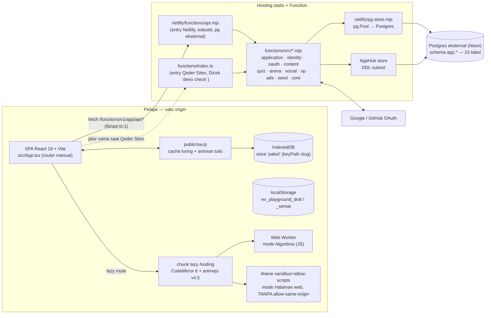
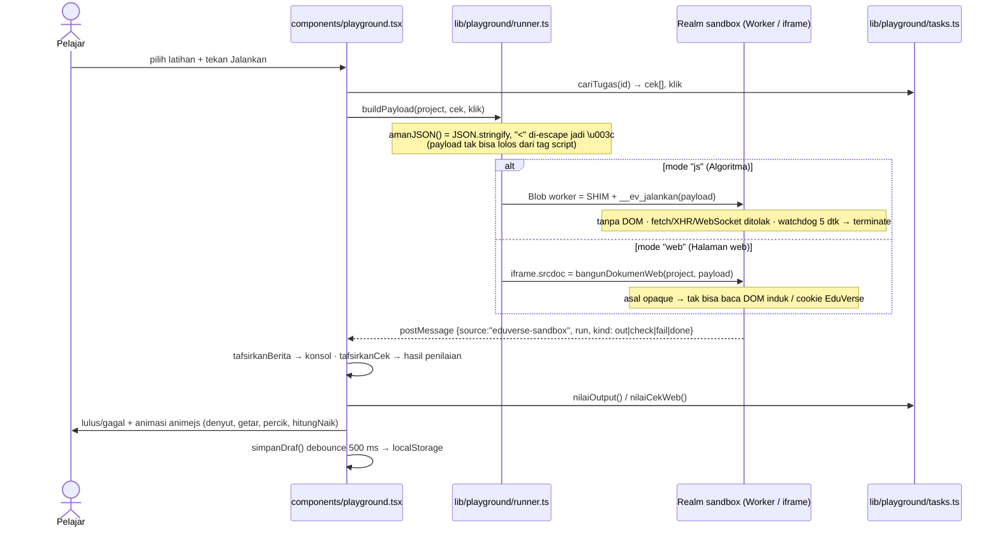
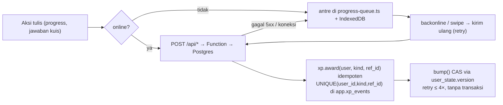

# EduVerse — Diagram arsitektur & alur

Dipetakan dari tree saat ini (commit `e2675df` + pekerjaan belum ter-commit di `/koding`).

## 1. Komponen

Kedua entry berbagi satu `functions/src/*` — jalur URL `/functions/v1/app/*` dijaga identik
supaya frontend, service worker, dan aturan asal permintaan tidak perlu cabang per host.

## 2. Sandbox playground (dua mode)

## 3. Alur tulis luring (tetap konsisten saat offline)

## 4. Gerbang verifikasi yang ada di repo

| Perintah | Isi | Status terverifikasi (2026-11-05) |
|---|---|---|
| `npm run test:function` | `dev/*.test.mjs` — 74 tes: Function, pg-store, entry Netlify + Vercel, playground, draf, skema, penjaga rute | lulus 74 / gagal 0 (terukur 2026-11-09) |
| `npm run build` | `tsc --noEmit` + `scripts/build.mjs` | hijau, `dist/assets/koding-DhGcim_f.js` 27,31 kB · CSS 164,26 kB (terukur 2026-11-09) |
| `npm run check:function` | `deno check functions/index.ts` | butuh Deno |
| penjaga skema | `dev/schema.test.mjs` — migrasi masuk subset DDL AppHub, tak ada tabel yatim, kolom Function ada di skema | lulus |

## 5. Keputusan per lingkungan host (bukan bug — jangan "diperbaiki" dengan menambah variabel)

| Host | Variabel Function | Konsekuensi yang SAH | Penjaga |
|---|---|---|---|
| Vercel Production | `DATABASE_URL` + `APP_SESSION_SECRET` + `APP_ALLOWED_ORIGINS` terisi | `/api/health` 200, `/api/catalog` 401 `login_required` untuk anonim, rute tak dikenal 404 `not_found` | `dev/vercel-entry.test.mjs` |
| Vercel Preview | **sengaja tanpa `DATABASE_URL`** (keputusan pemilik 2026-11-09) | `api/index.mjs:22` melempar saat impor → `FUNCTION_INVOCATION_FAILED` (500) untuk SEMUA `/api/*`, termasuk `/api/health`. Artinya: **login OAuth di Preview tidak akan pernah selesai** dan halaman yang butuh katalog akan gagal. 500 di Preview BUKAN regresi. | test `Preview tanpa DATABASE_URL gagal cepat di impor, dan itu keputusan — bukan regresi` (menjalakan `import('./api/index.mjs')` dengan env tanpa `DATABASE_URL` dan menuntut galat) |
| Netlify (Production + Preview) | tidak terverifikasi dari agen — situs memakai Team protection: `/`, `/api/health`, `/functions/v1/app/api/health` semuanya 401 · `server=Netlify` (terukur 2026-11-09) | Di SUMBER, prefiks `/functions/v1/app/*` hanya dipasang di `netlify/functions/api.mjs` (`config.path`). Apakah host-nya masih melayani kedua prefiks BELUM terbukti: butuh akun anggota tim yang masuk ke dashboard. | `dev/route-sync.test.mjs` (sumber saja) |

Tiga batas yang sering salah dibaca:

1. **Prefiks warisan hanya terpasang di Netlify.** Vercel mengambil rute dari nama berkas
   (`api/index.mjs` → `/api`) dan `vercel.json` tidak punya rewrite untuk `/functions/v1/*`,
   jadi di `eduverselearn.vercel.app` path itu 404 halaman `NOT_FOUND` platform (terukur
   404 · 79 B · 2026-11-09). Router inti tetap mengenal prefiksnya, jadi test titik masuk
   yang memakai prefiks itu membuktikan `applicationPath`, bukan dua host.
2. **Vercel terhubung ke Git dan `git push` yang menaikkan produksi.** Terukur 2026-11-09:
   push `bd7b67c..0e46589` membuat deployment production 18 detik lalu tanpa `vercel deploy`
   (alias `eduverse-git-main-…` ada, sha push membawa status GitHub `context=Vercel
   state=success`), dan `eduverselearn.vercel.app` kini menyajikan `index-CdlodoQH.css`
   = sama byte-nya dengan build lokal. Jangan simpulkan "tidak terhubung ke Git" dari
   `vercel inspect`: CLI 65.12.1 tidak mencetak baris repository di blok General.
3. **Build yang pernah diunggah lewat CLI meninggalkan artefak CSS.** Deployment lama
   (`index-3-DTADYc.css`, 173,269 B) adalah superset ketat dari build git (`164,265 B`):
   90 aturan ekstra, 0 aturan hanya-lokal, dan 70 di antaranya nama kelas yang ditulis apa
   adanya di `node_modules/tailwind-merge/dist/bundle-mjs.mjs` — Tailwind v4 ikut menscan
   node_modules di lingkungan build itu. Build dari Git sudah tidak mengulanginya.
